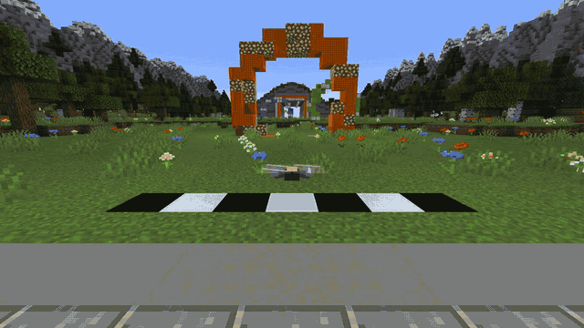

# FPVcraft

**Fly a real-feeling FPV racing drone in Minecraft — with your own RC transmitter.**

<p align="center">
  <a href="docs/media/demo.mp4"></a>
  <br><sub>▶ <a href="docs/media/demo.mp4">Watch the full demo video (1080p)</a></sub>
</p>

FPVcraft is a Fabric mod for Minecraft 1.21.1 that adds an FPV quadcopter driven by a full physics flight model,
not a flying camera. Thrust comes from motors and propellers, the battery sags under load, drag depends on the drone's attitude,
and acro mode behaves like a real flight controller. Plug in your EdgeTX/OpenTX radio and fly your Minecraft worlds
the way you fly real quads.

## Features

* **Real acro physics**: rigid-body quadcopter model with motor/prop thrust, battery voltage sag, per-direction
  aerodynamic drag, ground effect, prop wash and crash physics. Acro, Angle and 3D modes.
* **Your radio, your rates**: any USB-joystick transmitter (EdgeTX/OpenTX) or gamepad. A calibration wizard for
  stick modes 1-4, AETR/TAER presets, live two-stick preview. Betaflight, Actual, KISS, Raceflight and Quickrate rates, throttle mid/expo.
* **Four drones**: 5" race, 5" freestyle, 3" micro and 7" long-range presets.
* **FPV view with OSD**: camera uptilt, throttle, speed, battery and stick display. Press F5 for chase and front cameras.
* **Fly anywhere**: chunks load around the drone, so you can fly as far as you like. Your body waits safely where you took off.
* **Multiplayer**: everyone with the mod sees each other's drones and the pilots left standing at home.
  The pilot is never harmed while flying. The drone is part of the world: mobs chase it, explosions, lava and fire destroy it,
  water slows it down, and it triggers pressure plates and tripwires.
* **Drone sound**: layered motor sound that follows the RPM of each motor, plus wind, flips and crashes. Every sound is synthesized
  from scratch.
* **Engine-agnostic core**: the flight model is a standalone C++ library with a plain C API (`fpvcore`), so other games can use it too.

## Install

1. Install [Fabric Loader](https://fabricmc.net/use/installer/) for **Minecraft 1.21.1** and download **Fabric API**.
2. Download `fpvcraft-<version>.jar` from the [Releases](../../releases) page. One jar works on Windows and Linux (x86_64).
3. Put both jars into your `mods/` folder (or add them to a Fabric 1.21.1 instance in Prism, XMCL, etc.).
4. For multiplayer, install the mod on the server and on every client.

## Fly

| Key | Action |
|---|---|
| `G` | Launch the drone and enter FPV. Press again to land and return to your body |
| `K` | Controller setup and calibration |
| `F5` | Cycle camera: FPV, chase, front |
| `H` | Reset the drone in front of you |
| `,` | Next drone preset |
| Keyboard | `W/S` throttle, `A/D` yaw, arrows pitch/roll, `Z` arm, `X` flight mode |

Arm with the throttle all the way down, then throttle up (hover is just below centre stick). Commands: `/fpv preset`, `/fpv rates`,
`/fpv fov`, `/fpv uptilt`, `/fpv battery`, and more. See [docs/MINECRAFT.md](docs/MINECRAFT.md).

**Radio setup:** set your transmitter's USB mode to *Joystick (HID)*, plug it in before starting Minecraft, press `K` and run the wizard.
If Steam is running, disable Steam Input for the radio. Otherwise Steam turns the sticks into mouse and keyboard.

## Build from source

Needs a C++17 compiler, CMake, podman (for the portable Linux library) and JDK 21. See [docs/BUILDING.md](docs/BUILDING.md).

```
cmake -S . -B build && cmake --build build -j8 && ctest --test-dir build    # library + tests
cd adapters/minecraft-fabric && ./scripts/build-native.sh && ./gradlew build # mod jar
```

## Documentation

* [docs/MINECRAFT.md](docs/MINECRAFT.md): mod architecture, controls, multiplayer design and test matrix
* [docs/FLIGHT_MODEL.md](docs/FLIGHT_MODEL.md): the physics model
* [docs/LIBRARY.md](docs/LIBRARY.md) and [docs/API.md](docs/API.md): using `fpvcore` in your own game
* [docs/AUDIO.md](docs/AUDIO.md): how the sounds are synthesized
* [docs/LEGAL.md](docs/LEGAL.md): licences, where everything comes from, trademarks

## License

Code: [MIT](LICENSE). Sounds: CC0. Third-party notices: [NOTICE](NOTICE). Details: [docs/LEGAL.md](docs/LEGAL.md).

*FPVcraft is an unofficial fan project. It is not an official Minecraft product and is not approved by or associated with Mojang or Microsoft.*
